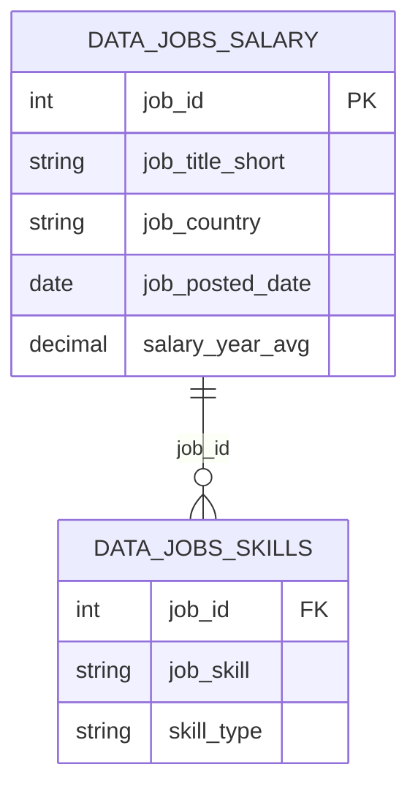
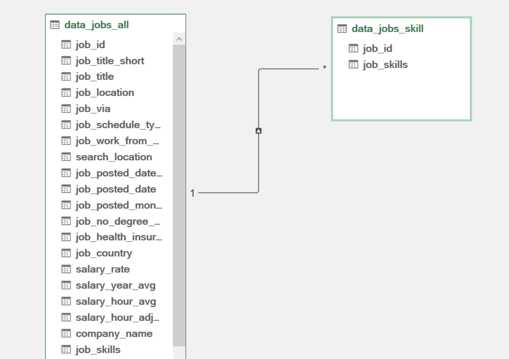
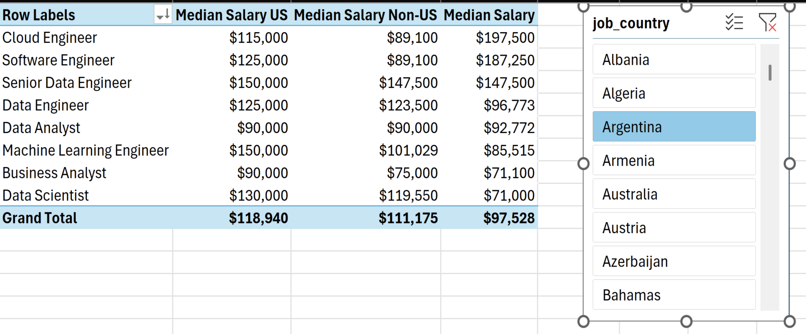
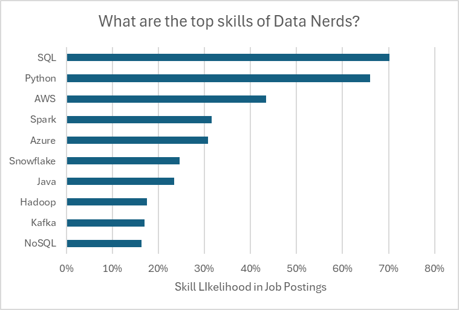
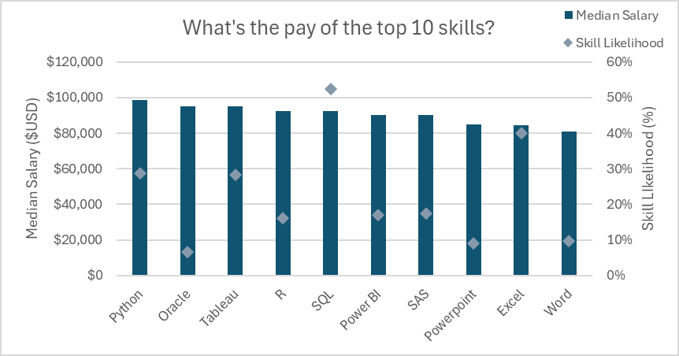
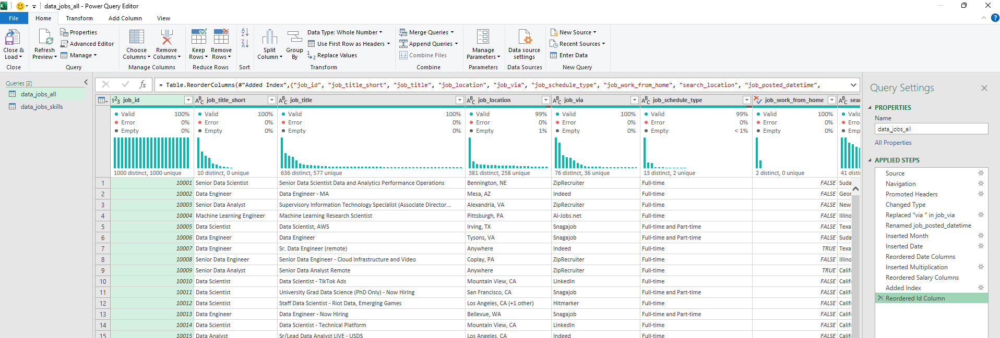
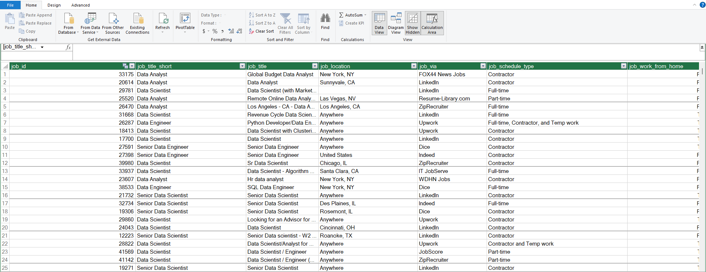

# Data Jobs Analysis with Excel


An end-to-end Excel analytics project exploring how skills, salaries, job roles, and geography shape the data job market. The solution uses **Power Query** to transform job-posting data, **Power Pivot** to build a relational data model, and **DAX**, PivotTables, slicers, and PivotCharts to turn the model into an interactive analysis.


## Project Overview

This project analyzes a 2023 dataset of data-related job postings to answer four practical career questions:

1. Do jobs requesting more skills offer higher salaries?
2. How do salaries compare between the United States and other regions?
3. Which technical skills appear most often in data job postings?
4. What salaries are associated with the ten most frequently requested skills?

The finished workbook separates job-level information from skill-level records, connects them through a one-to-many relationship, and provides five focused analysis sheets for exploring the results.

## Results at a Glance

| Metric | Result |
|---|---:|
| Jobs analyzed | 32,672 |
| Job-skill relationships | 167,270 |
| Average skills per job | 5.12 |
| Overall median annual salary | $115,000 |
| U.S. median annual salary | $118,940 |
| Non-U.S. median annual salary | $111,175 |
| Most frequently requested skill | SQL — 56.6% |
| Highest-paid top-ten skill | Spark — $140,000 median |

## Key Findings

- **SQL and Python dominate demand.** SQL appears in 56.6% of analyzed postings and Python in 54.1%, making them the two most broadly useful skills in the dataset.
- **Specialized infrastructure skills carry strong salaries.** Among the ten most common skills, Spark has the highest median salary at $140,000, followed by AWS at $135,000 and Java at $134,241.
- **Roles requiring broader skill sets generally pay more.** Senior Data Engineers average 8.14 skills per posting with a $147,500 median salary, while Business Analysts average 3.30 skills with an $85,000 median.
- **U.S. roles have an overall salary premium.** The U.S. median is $118,940 versus $111,175 outside the U.S.—a difference of $7,765, or approximately 7%.
- **Skill count is informative, but not the whole story.** The positive relationship between requested skills and salary is visible, yet job seniority, specialization, and location also influence compensation.

## Analytical Workflow


## Data Preparation with Power Query

Two queries reshape the source into a clean analytical model:

- **Job data query:** assigns data types, cleans source text, derives date and month fields, standardizes salary columns, and creates a unique job identifier.
- **Skills query:** retains the job identifier and skills field, removes brackets and quotation marks, splits skill arrays into columns, unpivots them into rows, trims text, standardizes capitalization, and groups skills into categories.

| Job data transformation | Skills normalization |
|---|---|
|  |  |

This design converts a wide, difficult-to-analyze skills field into a normalized table containing one row per job-skill combination.

## Data Model

The Power Pivot model links the job and skill tables through `job_id`:





The one-to-many model keeps job attributes at their natural grain while allowing every posting to be analyzed across multiple skills without duplicating job-level salary data.

## DAX Measures

The workbook contains reusable measures for counts, salary comparisons, and skill prevalence:

| Measure | Purpose |
|---|---|
| Job Count | Counts distinct job postings |
| Skill Count | Counts job-skill records |
| Skills Per Job | Calculates the average number of requested skills |
| Median Salary | Returns the overall median annual salary |
| Median Salary US | Calculates the median for U.S. postings |
| Median Salary Non-US | Calculates the median outside the U.S. |
| Median Salary - Skills | Evaluates median salary in the selected skill context |
| Skill Likelihood | Calculates the share of jobs requesting a skill |

Representative measures:

```DAX
Median Salary :=
MEDIAN(data_jobs_salary[salary_year_avg])

Median Salary US :=
CALCULATE(
    MEDIAN(data_jobs_salary[salary_year_avg]),
    data_jobs_salary[job_country] = "United States"
)
```

Using measures instead of hard-coded worksheet formulas allows the same calculations to respond dynamically to PivotTable filters and slicer selections.

## Analysis

### 1. Do More Skills Lead to Better Pay?


The scatter plot shows a generally positive relationship between the average number of requested skills and median salary. Senior Data Engineers stand out with the largest skill set—8.14 skills per posting—and a median salary of $147,500. Senior Data Scientists earn the highest median salary at $155,000 while averaging 5.26 skills, showing that the value and specialization of a skill set matter alongside its size.

### 2. How Do Salaries Differ by Region?



Across all roles, the U.S. median annual salary is approximately 7% higher than the non-U.S. median. The largest differences appear in several technical roles:

| Role | U.S. Median | Non-U.S. Median |
|---|---:|---:|
| Machine Learning Engineer | $150,000 | $101,029 |
| Software Engineer | $125,000 | $89,100 |
| Cloud Engineer | $115,000 | $89,100 |
| Data Scientist | $130,000 | $119,550 |

The workbook includes slicers so individual roles and locations can be compared interactively.

### 3. Which Skills Are Most In Demand?



SQL and Python are the clear leaders, each appearing in more than half of the analyzed postings. The next group includes Tableau, R, AWS, and Excel, showing that employers value a combination of querying, programming, visualization, cloud, and spreadsheet capabilities.

| Skill | Share of Jobs |
|---|---:|
| SQL | 56.6% |
| Python | 54.1% |
| Tableau | 21.6% |
| R | 21.2% |
| AWS | 20.9% |
| Excel | 19.2% |
| Spark | 16.2% |
| SAS | 14.7% |
| Azure | 14.6% |
| Java | 11.7% |

Percentages are independent because a single job can request multiple skills.

### 4. What Is the Pay of the Top Ten Skills?



The most common skill is not necessarily the highest paid. SQL and Python provide broad market coverage, while Spark, AWS, and Java are associated with the highest median salaries among the ten leading skills.

| Skill | Median Salary |
|---|---:|
| Spark | $140,000 |
| AWS | $135,000 |
| Java | $134,241 |
| Azure | $125,000 |
| Python | $125,000 |
| SQL | $120,000 |
| R | $119,550 |
| Tableau | $111,175 |
| SAS | $110,000 |
| Excel | $92,500 |

Together, these results suggest a useful career strategy: build a strong foundation in SQL and Python, then add specialized cloud or distributed-computing skills to target higher-paying technical roles.

## Workbook Structure

| Worksheet | Analysis |
|---|---|
| `Skill_Analysis` | Skill-record volume by job title |
| `Salary_vs_Skills` | Median salary compared with average skills per job |
| `Salary_Analysis` | Overall, U.S., and non-U.S. salary comparisons |
| `Skill_Job_Analysis` | Skill frequency and likelihood |
| `Skill_Salary_Analysis` | Median salary by skill |

The workbook contains five PivotTables, four slicers, and three embedded PivotCharts, supported by the Power Pivot data model.

## Skills Demonstrated

- Extracting, cleaning, and reshaping data with Power Query
- Normalizing a multi-value skills field through split and unpivot operations
- Designing a one-to-many relational model in Power Pivot
- Writing context-aware DAX measures
- Building PivotTables, slicers, and interactive PivotCharts
- Comparing salary distributions with medians instead of averages
- Translating analytical results into career-focused business insights

## Repository Structure

```text
data-jobs/
├── analysis.xlsx
├── README.md
└── Resources/
    ├── Chart1.png
    ├── Chart2.png
    ├── Chart3.png
    ├── Chart4.png
    └── Screenshot1.png ... Screenshot6.png
```

## Explore the Project

1. Download or clone this repository.
2. Open [`analysis.xlsx`](./analysis.xlsx) in the desktop version of Microsoft Excel.
3. Review the five analysis worksheets.
4. Use the available slicers to filter roles and compare the charts.
5. Inspect the Power Query steps and Power Pivot model to explore the full workflow.

> **Note:** The analysis represents a 2023 job-posting snapshot. Salary figures are annual medians and do not adjust for local cost of living, currency differences, experience, or company size. The results show associations in the observed postings rather than causal effects.

## Dashboard Preview

| Query output | Power Pivot data |
|---|---|
|  |  |

---

If you found this analysis useful, consider starring the repository.
